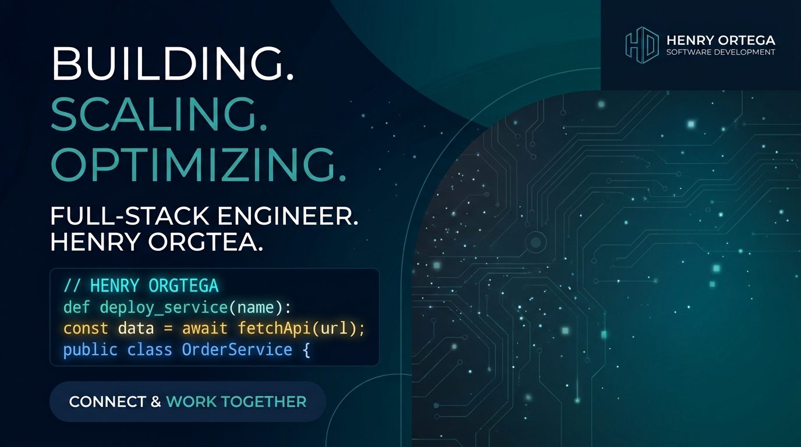

# ​🤠Henry Ortega Esis

Soy programador web junior. He hecho prácticas como **Programador Web en Gestinet** Internet Informàtica (Vilafranca del Penedès), donde trabajé con **WordPress**. Estoy aprendiendo a programar paso a paso, con especial interés en el desarrollo web y en crear aplicaciones útiles de principio a fin.

---

## 🛠️ Tecnologías

- **Python**: lenguaje principal de mis proyectos backend
- **Flask** (y Flask-SQLAlchemy): framework para aplicaciones web
- **SQLite / SQL**: bases de datos relacionales
- **HTML5 y CSS3**: maquetación y estilos
- **WordPress**: gestión de contenidos, páginas y publicaciones
- **Git y GitHub**: control de versiones

### 🌱 Aprendiendo ahora

- **Bootstrap** y **Tailwind CSS**: para crear interfaces modernas y responsive

---

## 🚀 Proyectos destacados

- **Wannapop**: aplicación web de compraventa de segunda mano desarrollada con Flask, Flask-SQLAlchemy y SQLite.
  
- **Próximo proyecto**: ¡actualmente en proceso! Pronto lo subiré aquí.

---

## 📫 Contacto

- **Correo:** [Henryortegaesis.19@gmail.com](mailto:Henryortegaesis.19@gmail.com)
- **LinkedIn:** [henry-ortega-esis](https://www.linkedin.com/in/henry-ortega-esis-b4626b289/)

